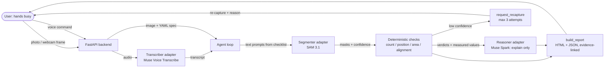

# SpecCheck architecture

Diagram source: [diagrams/speccheck-architecture.mmd](../diagrams/speccheck-architecture.mmd)
(renders below on GitHub). Rendered SVG/PNG/Excalidraw exports are pending:
the local diagram renderer needs its headless browser built first
(`cd ~/.Codex/skills/gstack && ./setup`), so no rendered triplet is claimed yet.

## Components

| Component | File | Responsibility |
|---|---|---|
| Tool layer | [speccheck/tools.py](../speccheck/tools.py) | Typed tools: `segment`, `measure_count`, `measure_position`, `compare_to_spec`, `request_recapture`, `build_report` |
| Deterministic checks | [speccheck/checks.py](../speccheck/checks.py) | All verdict maths on masks. PASS/FAIL only with confident evidence, else UNSURE |
| Agent loop | [speccheck/agent.py](../speccheck/agent.py) | segment -> compare -> explain -> recapture-or-report, max 3 attempts |
| Adapters | [speccheck/adapters/](../speccheck/adapters/) | `Segmenter` / `Reasoner` / `Transcriber` protocols. Mocks run today; Meta stubs carry TODOs pending DOCS_NOTES.md |
| Report | [speccheck/report.py](../speccheck/report.py) | Annotated image + per-item evidence (bbox, centroid, area, mask RLE, tool) as HTML + JSON |
| API | [speccheck/api.py](../speccheck/api.py) | `/api/check`, `/api/transcribe`, `/api/report/html`, `/api/sample/*`, serves the frontend |
| Frontend | [frontend/index.html](../frontend/index.html) | Webcam/upload capture, mic recording, YAML editor, results table, recapture banner |

## Key invariants

- A verdict with no evidence is UNSURE, never PASS (enforced in `checks._result`).
- The reasoner never overrides a deterministic verdict; it only explains.
- No Meta endpoint, model ID, or parameter exists in code until DOCS_NOTES.md
  confirms it from the official docs.
